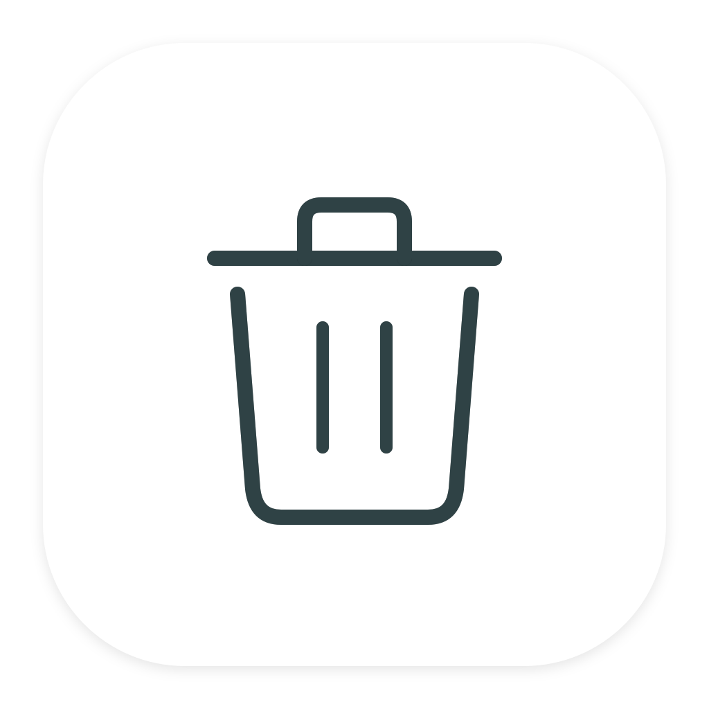
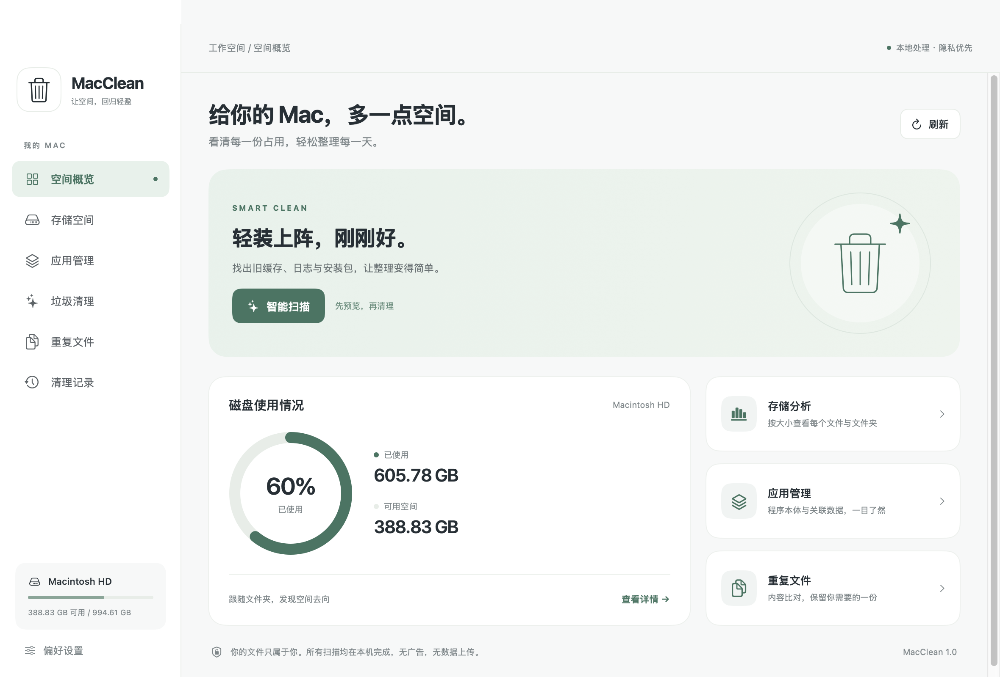

<div align="center">
  
  <h1>MacClean</h1>
  <p>看清每一份占用，让 Mac 回归轻盈。</p>
  <p>原生 SwiftUI · 离线运行 · 中文界面 · MIT 开源</p>
  <p><a href="https://github.com/Jumbo213/MacClean/releases/latest">下载 DMG</a> · <a href="https://github.com/Jumbo213/MacClean/issues">反馈问题</a></p>
</div>



## 功能

| 功能 | 说明 |
| --- | --- |
| 空间概览 | 实时读取磁盘总容量、已用与可用空间 |
| 存储分析 | 扫描整个磁盘、用户目录或指定文件夹；包含隐藏文件；逐层查看文件与文件夹占用，支持大小 / 名称排序、名称搜索、Finder 定位与复制路径 |
| 大文件整理 | 筛选当前扫描范围内逻辑大小 ≥ 100 MB 的文件，手动选择清理 |
| 应用管理 | 统计应用本体与 Bundle ID 精确匹配的缓存、设置、容器等数据；支持卸载及可选关联数据清理 |
| 垃圾清理 | 查找旧缓存、旧日志、Xcode 构建缓存、旧安装包、旧下载；预览后清理所选项目 |
| 重复文件 | 对 ≥ 1 MiB 的本地文件按大小分组、流式计算 SHA-256；每组固定保留最新的一份，多余副本需主动勾选；清理前再次核对保留副本及内容 |
| 清理记录 | 记录原路径、废纸篓路径、大小与时间；支持恢复，不覆盖原位置同名文件 |
| 忽略列表 | 在清理项目上右键忽略，可在设置中移除 |

## 安装

1. 在 [Releases](https://github.com/Jumbo213/MacClean/releases) 下载 `MacClean-1.0.0-universal.dmg`。
2. 打开 DMG，把 **MacClean.app** 拖入 **Applications**。
3. 打开应用，选择扫描范围；需要更多覆盖时，在「系统设置 → 隐私与安全性 → 完整磁盘访问权限」添加 MacClean，退出后重新打开。

支持 **macOS 13 Ventura 及更新版本**。Universal 2 安装包同时包含 **Apple Silicon / Intel** 架构。本机已验证 Apple Silicon；Intel 架构已交叉编译并经 Rosetta 启动，未在 Intel 实机验证。详细边界见 [验证记录](docs/VALIDATION.md)。

### 首次打开提示

当前 Release 使用 **ad-hoc 临时签名，未经 Apple Developer ID 签名与公证**，下载后 macOS 可能拦截。确认文件来自本仓库且校验一致后，在「系统设置 → 隐私与安全性」选择允许打开。不要全局关闭 Gatekeeper。也可以自行从源码构建。具体步骤参见 [Apple 官方说明](https://support.apple.com/zh-cn/102445)。

```bash
shasum -a 256 MacClean-1.0.0-universal.dmg
```

将结果与同一 Release 的 `SHA256SUMS.txt` 比对。

## 如何清理

1. 进入「垃圾清理」，点击「扫描垃圾」。
2. 默认只勾选至少 **14 天未修改**的缓存与日志；查看文件路径和原因，按需调整。
3. 点击「一键清理所选」，核对确认窗口后移到废纸篓。
4. 如需撤销，在「清理记录」点击恢复，或使用 Finder 废纸篓。

**移到废纸篓不会立即释放磁盘空间。** 确定不再需要后，由你在 Finder 中清空废纸篓；清空后无法通过 MacClean 恢复。

| 扫描规则 | 条件 | 默认勾选 |
| --- | --- | --- |
| `~/Library/Caches/*` | 项目及可读取子项至少 14 天未修改 | 是 |
| `~/Library/Logs/*` | 项目及可读取子项至少 14 天未修改 | 是 |
| `~/Library/Developer/Xcode/DerivedData/*` | 至少 30 天未修改 | 否 |
| `~/Downloads` 中 `.dmg` / `.pkg` / `.iso` 文件 | 至少 30 天未修改 | 否 |
| `~/Downloads` 中其他普通文件 | 至少 90 天未修改 | 否 |

扫描不会将“不常用”视为“没用”。旧下载可能是重要个人文件，请先核对。清理缓存后应用可能需要重建缓存，首次启动会变慢。建议先退出相关应用；MacClean 会跳过能识别的正在运行应用及其直接关联数据。

## 数据保护与统计边界

- 所有分析在本机完成，无网络请求、广告、遥测或后台清理服务；不请求管理员密码。
- 清理通过 macOS 废纸篓接口进行，不执行永久删除或自动清空废纸篓。
- 不跟随符号链接；保护系统目录、关键目录、用户主目录本身和 MacClean 恢复记录。
- 清理前重新检查设备、inode、文件类型、修改时间与大小；目录还会重新扫描并核对元数据摘要，变化或未完整读取时拒绝清理。文件系统仍可能被其他程序同时修改，因此应先退出相关应用。
- 不自动清理浏览器历史、Cookie、密码、邮件、照片图库、系统快照或应用文档。用户在存储页主动选择的个人文件需自行确认。
- 权限不足的位置会标记并列出，**扫描合计仅代表可访问内容**。完整磁盘访问权限也不会绕过 SIP / 其他用户文件权限。
- 列表占用来自文件系统分配块，硬链接在同一次遍历中计一次；大文件筛选与重复比对使用逻辑大小。APFS 克隆、压缩、快照、云端占位、目录开销和可清除空间会造成与系统存储分类的差异。数值不是承诺可释放空间。
- 从磁盘根目录扫描时跳过 `/dev`、`/net`、`/Network`、`/Volumes`、`/System/Volumes`，避免设备与重复挂载；可单独选择外置卷扫描。
- 应用本体扫描 `/Applications`、`~/Applications`、`/System/Applications`。关联数据只按 Bundle ID 精确匹配，不猜测同名目录、不包含共享 Group Container 与应用自行指定的数据目录，因此不能保证完整卸载。系统应用禁止卸载。
- 重复扫描跳过可识别的 iCloud 未下载文件和 dataless 占位文件，不主动下载云文件；扫描期间变化或不可读取的文件不参与比对。
- 恢复记录只保存在 `~/Library/Application Support/MacClean/history.json`（权限 `0600`），包含本地文件路径。请勿将记录或个人扫描结果提交到公开仓库。

## 从源码构建

需要 macOS、Swift 5.9+ 与 Xcode Command Line Tools（或完整 Xcode），无第三方依赖。

```bash
git clone https://github.com/Jumbo213/MacClean.git
cd MacClean
swift build --product MacClean
swift run MacClean
```

生成 Universal 2 `.app`、`.dmg` 与 SHA-256 清单：

```bash
./scripts/build.sh
# 产物位于 dist/
```

图标为代码绘制的白底简约线条垃圾桶，可重新生成：

```bash
swift scripts/make-icon.swift Resources
iconutil -c icns Resources/AppIcon.iconset -o Resources/AppIcon.icns
```

拥有自己的 Developer ID 证书与公证配置时：

```bash
MACCLEAN_SIGN_IDENTITY='Developer ID Application: Your Name (TEAMID)' \
MACCLEAN_NOTARY_PROFILE='your-keychain-profile' \
./scripts/build.sh
```

公证凭证应通过 `xcrun notarytool store-credentials` 存入钥匙串，禁止写入源码。未配置证书时脚本只进行 ad-hoc 签名。

## 验证

核心回归检查不依赖 XCTest，可直接使用 Command Line Tools：

```bash
swift run MacCleanChecks
# 包含真实废纸篓往返测试，只操作自动创建的临时夹具：
MC_INTEGRATION_TRASH=1 swift run MacCleanChecks
```

覆盖递归统计、隐藏文件、硬链接、符号链接、取消扫描、重复内容、扫描后变动、清理时间规则、运行中缓存、受保护目录、路径边界、应用数据匹配、损坏恢复记录和废纸篓恢复。

`MacCleanChecks` 是独立命令行回归程序，不使用 `swift test`。临时夹具在当前目录 `.build/fixtures-*` 中创建，正常退出后删除；真实废纸篓测试会恢复夹具，并验证同名文件不被覆盖。

UI 渲染检查（应用不扫描、不清理，默认仅打开概览）：

```bash
dist/MacClean.app/Contents/MacOS/MacClean --capture /absolute/path/overview.png
hdiutil verify dist/MacClean-1.0.0-universal.dmg
codesign --verify --deep --strict dist/MacClean.app
```

## 项目结构

```text
Sources/MacClean/          SwiftUI 界面与主线程状态管理
Sources/MacCleanCore/      文件扫描、清理规则、重复比对、保护策略与恢复
Tests/MacCleanCoreTests/   独立核心回归检查
Resources/                Info.plist 与应用图标
scripts/                  图标生成与 Universal DMG 打包脚本
docs/                     截图、安装说明与发行说明
.github/workflows/        构建检查和标签发行
```

扫描与 SHA-256 在后台执行，可取消；界面更新在主线程。大目录结果会占用与文件数量相应的内存，建议从具体目录开始。

## 贡献与许可

欢迎提交 Issue / Pull Request。请用临时夹具重现问题，提交截图和日志前隐藏个人路径及文件内容。涉及清理策略的修改必须补充保护与恢复验证。

[MIT License](LICENSE) © 2026 Jumbo213
